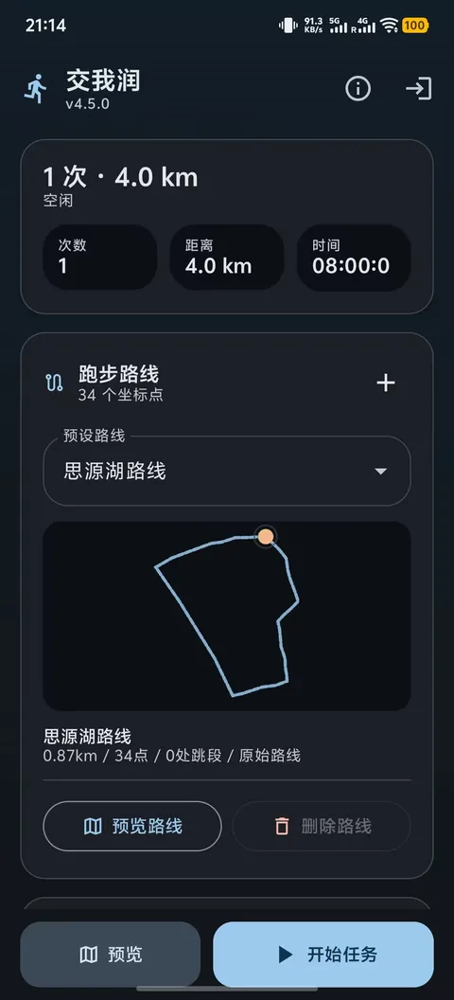
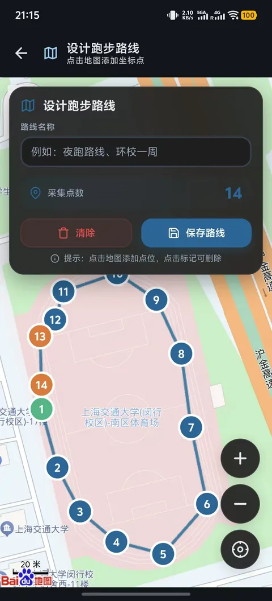

# Android Guide

Version **`4.5.0`** (`versionName` in `apps/android/app/build.gradle.kts`, `versionCode = 40500`). Project path: `apps/android/`.

## Contents

- [1. Install](#1-install)
- [2. Login](#2-login)
- [3. Parameters](#3-parameters)
- [4. Semester data](#4-semester-data)
- [5. Uploading](#5-uploading)
- [6. Custom routes](#6-custom-routes)
- [7. Permissions](#7-permissions)

## 1. Install

1. Download the APK from [Releases](https://github.com/JackyTJie/SJTURunningMan_Advanced_Edition/releases).
2. Transfer it to your phone.
3. Tap to install. Android may warn about unknown sources — allow installation from that source.

> Requires Android 8.0 (API 26) or later. `minSdk = 26`, `targetSdk = 34`.

## 2. Login

1. On launch the app opens the JAccount login page to obtain a cookie. You can log in manually or use the one-tap "交我办" flow.
2. The cookie is validated automatically and re-acquired when it expires.
3. If it keeps failing, clear the app data in system settings and start over.

## 3. Parameters

| Parameter | Range | Default | Notes |
| --- | --- | --- | --- |
| Run count | 1–30 | 1 | First run: use 1 to verify |
| Start time | 0–23 h, 0–59 min | 08:00 | Randomized per record |
| End date | date picker | yesterday | Earlier records generated backwards |
| Skip days that already have a record | toggle | on | Skipped days move to earlier dates while the record count stays as configured; looks back at most 120 days and never past the semester start, and reports honestly when it cannot fill the count |
| Target distance | 1–5 km | 4 km | Target per record |
| Custom route | see below | Siyuan Lake route | Draw on a separate page |

Ranges come from `apps/android/app/src/main/java/com/sjtu/runner/config/AppConfig.kt`.

## 4. Semester data

The main screen has four tabs — **Run console / Route manager / Task log / About** — matching the desktop app one to one.

- **"本学期进度" card** (Run console): shows the current semester's qualifying kilometres and completion rate. When you are not logged in, or the sync fails, it shows `--` and the calendar stays a placeholder.
- **"学期日历"** (Task log): weeks start on Monday and the semester is laid out month by month. Solid green = counted towards results, outlined = invalid record, grey = no run, blank cell = outside the semester. If the server does not return the semester range it says "服务器未返回本学期起止日期。"
- **Plan set automatically after login**: the first semester sync after a successful login derives "run count × distance per run" from the kilometres still missing this semester (1–5 km per run, at most 30 runs, rounded up so the gap is actually covered) and fills the inputs. If you have edited either value by hand they stay as they are, with the reason logged only. Auto-filled values survive a restart.
- **Overlay notices**: "logged in", "route imported", "plan set automatically" and similar messages float at the top of the page and collapse after 5 seconds instead of pushing the content below down; the same text stays in the Task log.
- **The "跑步路线" card lives only on the Route manager tab**: the "预览" button on the Run console switches to that tab to preview the selected route.
- Semester data is shown for the current session only and is **never persisted**; a failed sync logs a single line, leaves the login state untouched and never logs you out.

## 5. Uploading

1. Tap "开始任务" (start task).
2. Watch the progress bar and status text. On other tabs a compact running bar stays at the top so you can stop at any time.
3. Success/failure counts appear when it finishes.

The log panel prints generation and upload progress per record, with a few seconds between records.

## 6. Custom routes

1. Open the route design page and tap points on the map **in order**.
2. More points give a better fit. **Order matters, and the start should be close to the finish.**
3. Save, return to the main screen and run again.

Coordinate format and system differences: [routes.md](./routes.md).

## 7. Permissions

Declared in `AndroidManifest.xml`:

| Permission | Purpose |
| --- | --- |
| `INTERNET` | Upload to pe.sjtu.edu.cn and check for updates |
| `ACCESS_NETWORK_STATE` | Network availability checks |
| `READ_PHONE_STATE` | Device identifier used in request headers |

Cleartext traffic is enabled (`usesCleartextTraffic`).

Troubleshooting: [faq.md](./faq.md). Building yourself: [build.md](./build.md).
