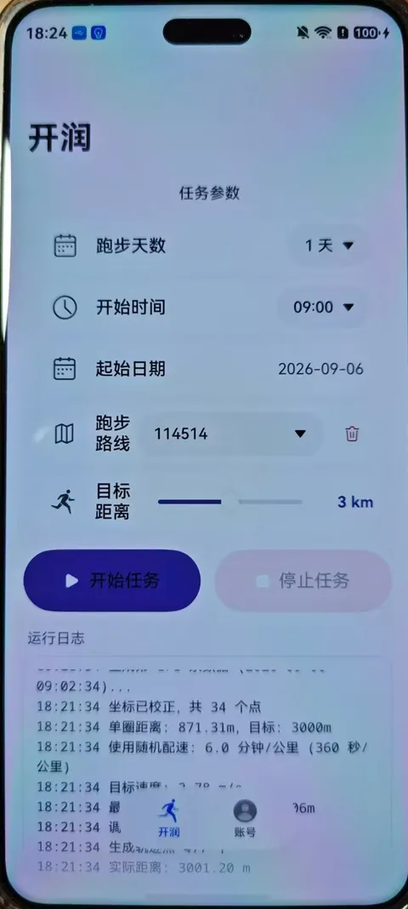

# HarmonyOS NEXT Guide

Version **`4.2.0`**, bundle name `com.sjtu.runner` (`apps/harmonyos/AppScope/app.json5`). Project path: `apps/harmonyos/`.

> **Anything not stated here matches the Android build** — parameter ranges, upload flow and logging are aligned. Only the install procedure and login entry point differ.

The HarmonyOS build was contributed by [@AetherWish](https://github.com/AetherWish); the project was migrated from the Android native project (see `apps/harmonyos/oh-package.json5`).

## Contents

- [1. Installing the HAP](#1-installing-the-hap)
- [2. Login](#2-login)
- [3. Differences from other platforms](#3-differences-from-other-platforms)

## 1. Installing the HAP

> ⚠️ **Complete Huawei developer verification first** to extend the debug certificate validity. Without it the debug certificate expires quickly and you must reinstall.

1. **Build the HAP yourself first** — this project **does not ship a prebuilt HarmonyOS package** in Releases. Build and sign it with DevEco Studio, see [build.md](./build.md#harmonyos).
2. On the phone: **Settings → About → tap "Software version" 7 times**, restart, and developer options are enabled.
3. Go to **Settings → System → Developer options → Wireless debugging**, enable it and note the IP and port.
4. Connect the PC and phone to the same network, download [小白调试助手](https://github.com/likuai2010/auto-installer) and run it, following its on-screen instructions.

## 2. Login

Open the **Account** tab and tap **JAccount 账号** to reach the login page.

> ⚠️ HarmonyOS **cannot** launch the one-tap "交我办" login — web login only.

## 3. Differences from other platforms

| Item | Android | HarmonyOS |
| --- | --- | --- |
| How to get it | Download the APK from Releases | **No prebuilt package** — build and sign it yourself with DevEco Studio |
| Install | APK | HAP + debug certificate (limited validity) |
| One-tap login | Yes | No, JAccount web login only |
| Parameters | 1–30 runs / 1–5 km | Same as Android |
| Route asset | `route_design.html` (Baidu Maps) | Same, stored separately |

Building and packaging: [build.md](./build.md). Coordinate systems: [routes.md](./routes.md).
