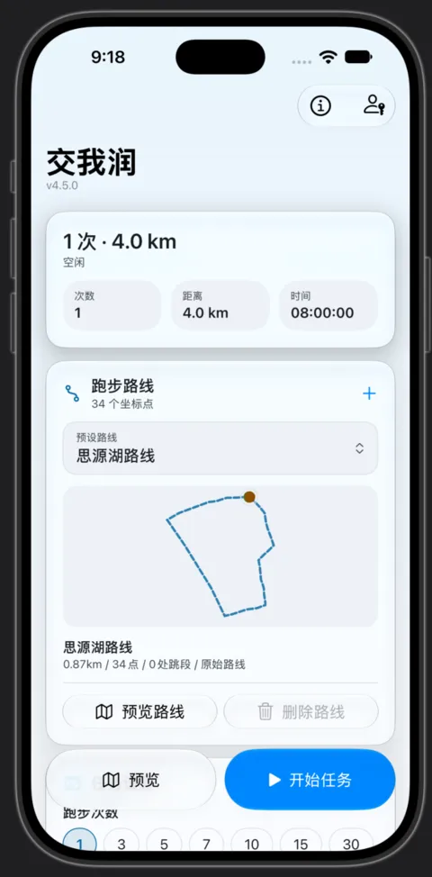

# iOS 版使用指南

版本 **`4.5.0`**（`MARKETING_VERSION`，与 `apps/ios/SJTURunningMan/AppConfig.swift` 的 `versionName` 一致），Bundle ID `SJTU.SJTURunningMan`。工程路径 `apps/ios/`。

iOS 版**没有预编译安装包**，需要用 Xcode 自行编译并签名后安装到 iPhone。



## 目录

- [1. 环境要求](#1-环境要求)
- [2. 克隆并打开工程](#2-克隆并打开工程)
- [3. 配置签名](#3-配置签名)
- [4. 编译并运行](#4-编译并运行)
- [5. 使用](#5-使用)
- [6. 文件结构](#6-文件结构)

## 1. 环境要求

- **macOS** + **Xcode 16 或更高**
- 一个 **Apple Developer 账号**（免费账号即可）
- 一台 **iPhone**，iOS 版本需满足 `IPHONEOS_DEPLOYMENT_TARGET = 26.5`

## 2. 克隆并打开工程

```bash
git clone https://github.com/JackyTJie/SJTURunningMan_Advanced_Edition.git
cd SJTURunningMan_Advanced_Edition/apps/ios
open SJTURunningMan.xcodeproj
```

## 3. 配置签名

### 设置 Team ID

1. 在 Xcode 左侧导航栏选中顶层的 **SJTURunningMan** 工程；
2. 进入 **Signing & Capabilities** 标签；
3. 在 **Team** 下拉中选择你的开发者团队，Xcode 会自动填入 Team ID。

或者直接编辑 `SJTURunningMan.xcodeproj/project.pbxproj`，把 `YOUR_TEAM_ID` 换成你 10 位的 Apple Developer Team ID。

> **去哪找 Team ID**：[developer.apple.com/account](https://developer.apple.com/account) → **Membership** → 页面顶部的 **Team ID**。

### 设置 Bundle Identifier（可选）

默认是 `SJTU.SJTURunningMan`。若用免费开发者账号，通常需要改成唯一的，比如 `com.你的名字.SJTURunningMan`：

1. 选中工程 → **Signing & Capabilities**；
2. 修改 **Bundle Identifier** 为唯一值；
3. Xcode 会自动生成描述文件。

## 4. 编译并运行

### 方式 A：直接用 Xcode（最简单）

1. 用数据线把 iPhone 连到 Mac；
2. 在 Xcode 顶栏把构建目标选成你的 iPhone；
3. 点 **Play ▶**（或 `Cmd+R`）。

首次运行可能遇到：

- **「Enable Developer Mode on this iPhone?」** —— 手机上点 OK，然后去 **设置 → 隐私与安全性 → 开发者模式** 打开，重启手机；
- 免费账号报 **「Failed to register bundle identifier」** —— 按上一节把 Bundle ID 改成唯一的；
- 需要**信任开发者证书** —— iPhone 上 **设置 → 通用 → VPN 与设备管理 → 开发者 App → 信任**。

### 方式 B：打包 ipa 后侧载（不需要数据线）

1. Xcode 菜单 **Product → Archive**（如有需要先 `Cmd+Shift+K` 清理）；
2. 在 Archives 窗口选中归档，点 **Distribute App**；
3. 选择 **Custom → Export as .ipa**；
4. 保存 `.ipa`，用 AltStore / SideStore 等侧载工具安装。

## 5. 使用

1. **登录** —— 应用打开 JAccount OAuth2 登录页，用学号密码登录；
2. **设置参数** —— 配置跑步次数、时间、日期、距离（1–5 km，默认 4 km）；
3. **开始** —— 点「开始任务」，应用会：
   - 从体育平台获取你的 UID；
   - 依据路线坐标生成 GPS 轨迹数据；
   - 配速在 4–6 min/km 之间随机；
   - 逐天上传轨迹数据。
4. **观察** —— 实时日志显示进度；
5. **重新登录** —— 会话过期时应用会提示重新登录。

## 6. 文件结构

```
apps/ios/
├── SJTURunningMan/
│   ├── SJTURunningManApp.swift      应用入口
│   ├── LoginView.swift              JAccount OAuth2 WebView
│   ├── MainView.swift               参数设置与界面
│   ├── MainViewModel.swift          上传逻辑与状态
│   ├── ApiService.swift             HTTP 客户端（取 UID、上传结果）
│   ├── DataGenerator.swift          GPS 轨迹生成
│   ├── GpsUtil.swift                坐标工具
│   ├── RouteManager.swift           路线管理
│   ├── RouteDesignView.swift        路线设计页
│   └── route_coordinates            SJTU 校园预录路线坐标点
├── SJTURunningMan.xcodeproj/        Xcode 工程
└── README.md                        目录内简短指引
```

故障排查见 [faq.md](./faq.md)；自行编译与其他平台见 [build.md](./build.md)。
